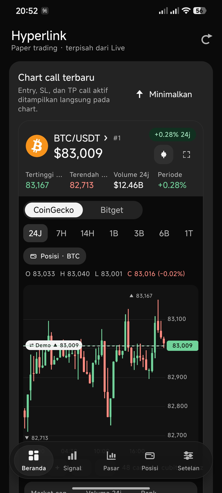
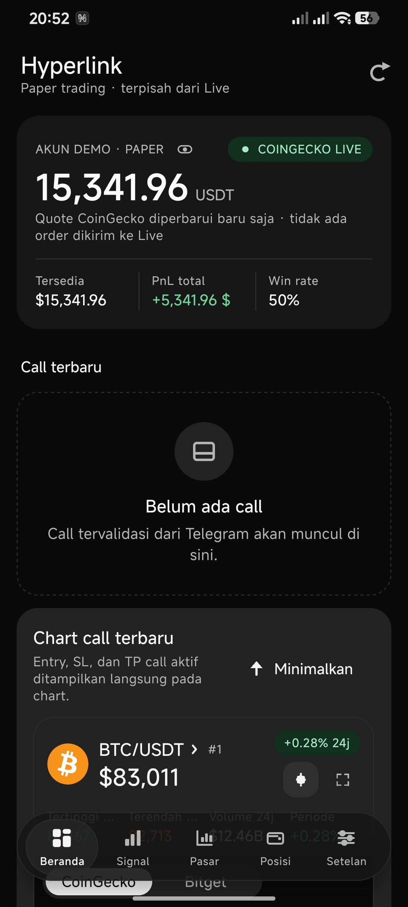
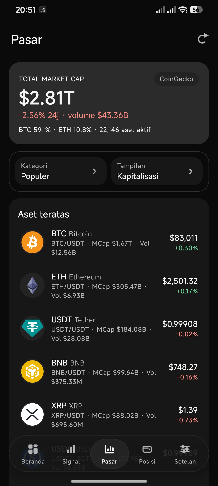
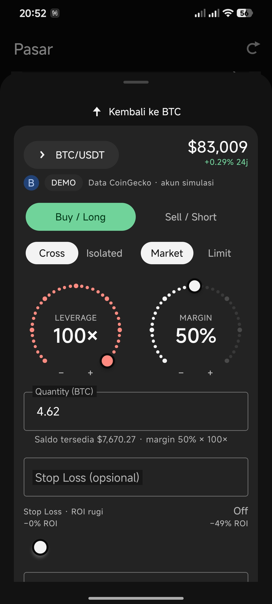
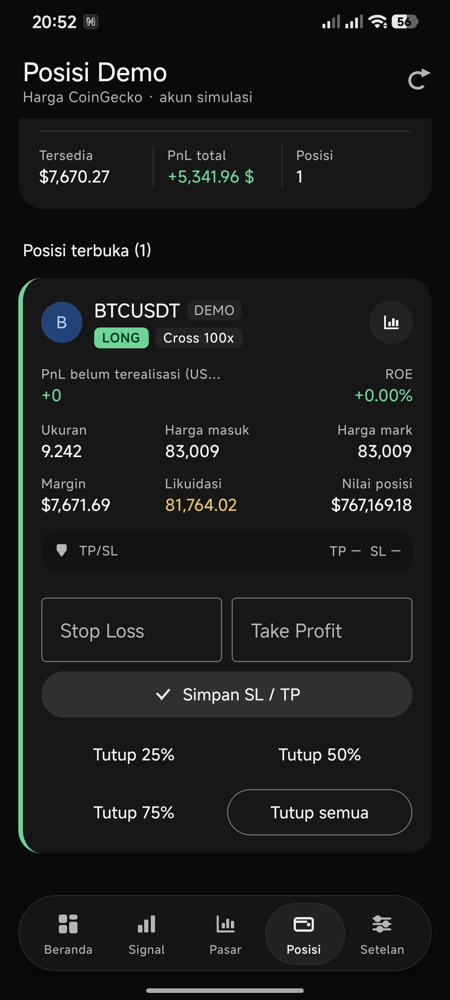
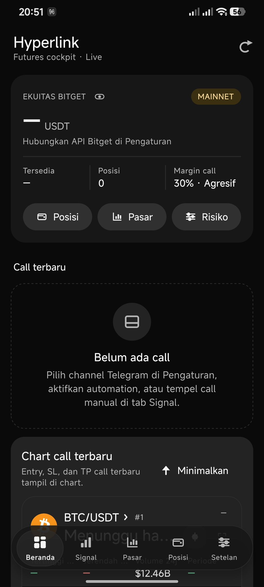

# Hyperlink 3.1.1

**Hyperlink** adalah aplikasi Android berbasis React Native untuk memantau call futures, menguji strategi lewat paper trading, melihat data pasar/chart, dan—jika dikonfigurasi secara sadar—menghubungkan akun exchange. Fokus awal yang disarankan adalah **Demo/testnet**.

> **Peringatan risiko:** futures crypto berisiko tinggi. Data, sinyal, dan analisis AI dapat keliru. Aplikasi ini bukan saran keuangan. Selalu uji di Demo/testnet dan periksa order sebelum memakai dana nyata.

## Unduhan

- [APK Android v3.1.1 (arm64-v8a)](releases/Hyperlink-v3.1.1-arm64-v8a.apk)
- [Source code lengkap v3.1.1 (ZIP)](releases/Hyperlink-v3.1.1-source.zip)
- [SHA-256 APK dan source ZIP](releases/SHA256SUMS.txt)
- [Panduan konfigurasi API](docs/API_SETUP.md)
- [Build dan release](docs/BUILD_AND_RELEASE.md)
- [Catatan keamanan](SECURITY.md)

| Detail rilis | Nilai |
|---|---|
| Versi | 3.1.1 (versionCode 35) |
| Package Android | `com.tradepilotnative` |
| Arsitektur APK | `arm64-v8a` saja |
| Android minimum | API 31 / Android 12 |
| Target Android | API 36 |
| Tanda tangan APK yang disertakan | Sertifikat debug Android — **bukan signing produksi** |

APK ini cocok untuk evaluasi/pemasangan manual. APK bukan rilis Play Store dan build yang disertakan tidak ditandatangani dengan kunci produksi. Jangan mengandalkannya untuk pembaruan aplikasi bertanda tangan lain; baca [panduan signing](docs/BUILD_AND_RELEASE.md).

## Screenshot

| Beranda & chart Demo | Ringkasan Beranda | Pasar |
|---|---|---|
|  |  |  |

| Form order Demo | Posisi Demo | Dashboard Live belum tersambung |
|---|---|---|
|  |  |  |

Screenshot menunjukkan antarmuka yang dikirim pemilik proyek. Saldo dan posisi Demo adalah data simulasi; dashboard Live pada gambar terakhir belum tersambung ke API exchange.

## Fitur

### Penyegaran UI v3.1.1

- Navigasi bawah lebih transparan agar backdrop blur terlihat jelas.
- Kartu call terbaru di Beranda Live dan Demo dimulai dalam keadaan ringkas; pengguna dapat membuka atau meminimalkannya.
- Popover, menu, bottom sheet, dan konfirmasi meredupkan serta memburamkan latar; aksi berisiko tetap meminta konfirmasi.

### Pasar, chart, dan sinyal

- Tab **Beranda, Signal, Pasar, Posisi,** dan **Setelan**.
- Feed harga pasar publik CoinGecko atau ticker exchange yang dipilih; pencarian pair, kategori, dan daftar aset.
- Chart candle/garis dengan pilihan timeframe yang tersedia, quote, dan penanda entry/SL/TP dari call atau posisi.
- Input call manual dan pembacaan riwayat channel Telegram yang dipilih.
- Parser lokal untuk format call umum; Gemini dapat membantu menganalisis pesan yang tidak cocok dengan parser dan memberi saran margin berbatas.
- Validasi arah Stop Loss/Take Profit, rentang entry, leverage, rasio risiko, dan confidence sebelum sebuah call diterima.

### Paper trading Demo

- Saldo dan posisi simulasi **lokal**; tidak mengirim order ke exchange.
- LONG/SHORT, market/limit, leverage, Cross/Isolated, entry tertunda, TP/SL, penutupan sebagian/semua, PnL, dan histori Demo.
- Sumber harga Demo dapat menggunakan CoinGecko atau feed publik exchange terpilih.
- Backup/restore akun Demo melalui JSON pada menu AI & data.

### Integrasi Live (opsional)

- Adapter API untuk **Bitget, Bybit, OKX,** dan **Binance**.
- Sinkron saldo/posisi dan pengelolaan posisi yang didukung adapter, termasuk SL/TP serta penutupan sebagian.
- Order Live manual memerlukan konfirmasi akhir; Stop Loss diwajibkan oleh alur aplikasi.
- Auto-entry call Telegram bersifat opsional dan default **nonaktif**; perlu opt-in Live dan kondisi pengaman yang sesuai.
- Ada kill-switch, mode hanya-baca, batas risiko harian/jumlah posisi, dan pengingat leverage. Pengaman mengurangi risiko, tetapi tidak menghilangkannya.
- Bybit, OKX, dan Binance menyediakan pilihan lingkungan testnet/demo di aplikasi; Bitget tidak menyediakan testnet publik dalam alur aplikasi ini. Periksa label lingkungan di Setelan sebelum menghubungkan akun.

### Pengalaman dan keamanan perangkat

- Tema Monochrome, Material You, Midnight Exchange, Emerald Wallet, Aurora Slate, dan Copper Studio; mode warna sistem/terang/gelap.
- PIN enam digit, opsi biometrik jika didukung perangkat, sembunyikan saldo, notifikasi lokal, alert harga, dan beberapa template suara termasuk DeafDeep.
- Kredensial dimasukkan di aplikasi dan dikelola melalui `react-native-keychain`; jangan commit API key, passphrase, API Hash, atau data sesi ke Git.

## Instalasi APK

1. Unduh APK dari bagian [Unduhan](#unduhan) ke ponsel Android **arm64** dengan Android 12 atau lebih baru.
2. Buka file APK. Jika Android meminta izin, izinkan pemasangan aplikasi dari file manager/browser yang digunakan, lalu pasang.
3. Buka Hyperlink dan mulai dari mode **Demo**. Izin notifikasi bersifat opsional.
4. Untuk menghubungkan layanan, ikuti [panduan konfigurasi API](docs/API_SETUP.md). Jangan beralih ke Live sebelum menguji pengaturan di Demo/testnet.

Android mungkin menampilkan peringatan karena APK dipasang dari luar Play Store. Paket ini bukan distribusi Play Store. Jangan memasang APK dari sumber yang tidak dipercaya.

## Build dari source

Prasyarat utama: Node.js **22.11+**, JDK **21**, Android SDK platform **36**, Build Tools **36.1.0**, dan NDK **27.1.12297006**. Unduh dan ekstrak ZIP source v3.1.1; jalankan perintah berikut dari folder `xo3` hasil ekstraksi:

```bash
npm ci
bash scripts/prepare-tdlib.sh
npm run typecheck
npm test -- --runInBand
cd android
./gradlew assembleRelease
```

APK hasil build berada di `android/app/build/outputs/apk/release/app-release.apk`. Build release tanpa signing key sendiri memakai sertifikat debug; ikuti [panduan build/signing](docs/BUILD_AND_RELEASE.md) untuk membuat rilis milik Anda. Workflow GitHub Actions tersedia di `.github/workflows/android.yml`.

## Source dan lisensi

ZIP source v3.1.1 mencakup kode JavaScript/TypeScript, konfigurasi Android/iOS, test, aset, dan lockfile. `node_modules`, output build, API credentials, dan keystore signing tidak disertakan. Kode sumber belum memiliki file lisensi. **Jangan menganggap source ini memberi izin penggunaan ulang atau distribusi ulang.** Tinjau lisensi dependency dan aset pihak ketiga di `SOUND_ASSETS.md` sebelum distribusi.

## Status pemeriksaan

APK v3.1.1 dibuat sebagai satu task Android release untuk `arm64-v8a`; metadata terverifikasi sebagai package `com.tradepilotnative`, versionCode 35, minimum API 31, dan target API 36. Tanda tangan APK v2 valid, tetapi memakai sertifikat debug Android—**bukan signing produksi**. SHA-256 kedua berkas rilis tercantum di `releases/SHA256SUMS.txt`. Ini bukan audit keamanan atau validasi trading pada akun/perangkat nyata; sebelum memakai Live, uji di testnet/demo dan verifikasi semua parameter order secara manual.
